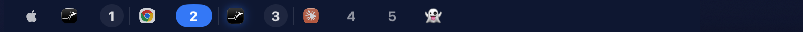

# Lefty

Workspaces on the left, your macOS menu bar on the right.

## Previews



Shown with the cover matched to the wallpaper and the native palette. By default the cover is the palette's surface colour.

## What it changes

A half-width bar in the menu bar's left corner. Workspaces are numbered circles, and the focused one becomes a filled blue pill. The macOS menu bar items on the right stay as they are. The bar hides the current app's menus and adds an Apple button and an app button that open them. Popouts have rounded panels with a faint glow along the bottom edge. The palette follows the system's light and dark appearance.

## Controls and commands

Change these in `shell.toml`, under your profile:

```toml
[profiles.lefty.widgets.workspaces]
cover = "#0C1733"   # surface, background, elevatedSurface or a #RRGGBB colour
coverWidth = 616    # the bar's width in points, minus 8

[profiles.lefty.widgets.workspaces.displays.SAMSUNG]
cover = "#364996"   # for the display with this name; either key may be left out
coverWidth = 700
```

- A transparent bar would show the app menus through the workspaces, so the cover is opaque. For a seamless bar, turn on **Show menu bar background** in macOS **System Settings > Menu Bar**, which paints the menu bar one flat colour, and set `cover` to that colour. Without it, choose a colour close to your wallpaper's top edge. macOS tints that background from the wallpaper, and the cover is one fixed colour per display, so both suit a still wallpaper.
- `coverWidth` hides app menus up to that width, and the bar grows past it when the workspaces need more room. The default clears the notch at a MacBook's default resolution. At a larger text size, set it to about 0.44 of the display's width minus 60. macOS may move menu bar icons to the left of the notch, and they need that gap to stay visible and clickable.
- The bar is 30 pt tall and stays in the top left corner. With a shorter menu bar, windows move down to make room.
- Keep workspaces as the bar's only widget. Others would not be covered.

## Credits and licences

Style code is GPL-2.0-only, as declared in [style.toml](style.toml). The look module follows the structure of OmniWM's Sakura style, (C) 2026 OmniNull, GPL-2.0-only. No fonts are bundled; text uses the system font.
