With **macOS Fusion**, you arrange the Niri (scrolling) layout with the mouse, the same way you move windows anywhere else in macOS. Drag a window by its title bar and the other windows make room for it as you go, so you always see where it will land. Let go and it drops into place. You can also put windows into stacks and take them out again, resize them by their edges, and carry a window to another display.

Turn it on in **Settings → Layouts → Niri**, in the **macOS Fusion** section. It is off by default; while it is off, a window dragged by its title bar snaps back when you let go, as before.

:::tip
macOS has its own tiling, which starts when you drag a window to a screen edge or hold `Option`. It gets in the way of dragging. If any of it is on, the Niri settings list the macOS settings to turn off and give you a button that opens **Desktop & Dock**.
:::

## Moving a window

Drag the window by its title bar. It lifts off the strip and follows the pointer, and its old place stays open as an empty **home spot**.

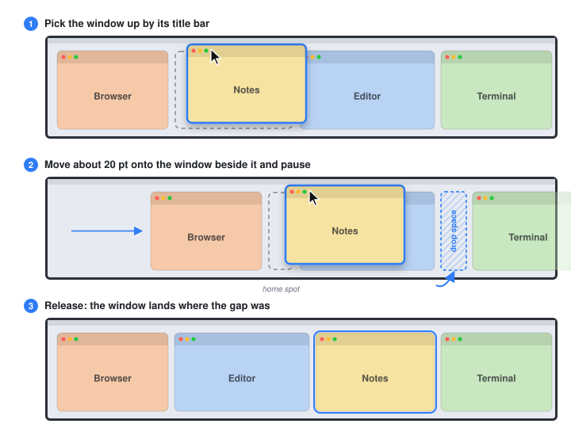

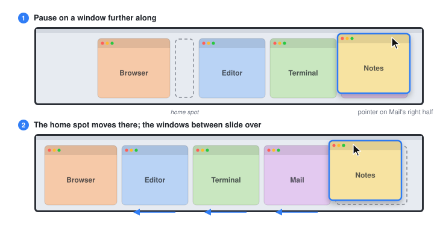

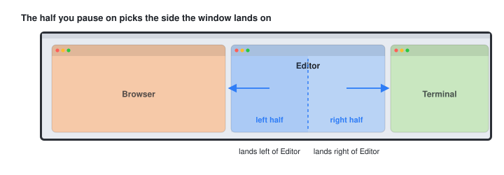

- **The window next to it:** move about 20 points onto the window beside the one you're dragging. A narrow **drop space** opens on its far side, and that window stays where it is.
- **A window further along:** pause on it. When everything involved fits on screen, the home spot moves next to it and the windows in between slide over. What you see is where the window will land.
- **Which side:** the half of the window you pause on decides. The left half lands yours to its left, the right half to its right.
- **Crossing is safe:** nothing moves until you pause, so you can sweep across several windows to reach the one you want. Letting go over a window before anything opened still lands yours on its far side.
- **Changing your mind:** move back over the home spot, or over the half of a window that faces it, and the window goes back to its old place. Esc doesn't cancel a drag; drag the window back, or use Undo afterwards.
- **The view stays:** after a drop, the strip goes back to where it was before the drag if the dropped window is visible there.
- **Keys don't change a drag:** holding `Option`, `Command`, `Control` or `Shift` while dragging a title bar makes no difference. While macOS Fusion is on, the **Left Mouse Move Modifier** move (`Option`-drag from anywhere in a window) is off in the Niri layout; other layouts keep it.
- **Clicking doesn't scroll:** pressing on a window that is only partly on screen doesn't move the strip. A plain click scrolls it into view when you let go.

## Reaching windows off screen

When you pause on a window that runs off the screen, a drop space opens beside it and the strip scrolls just far enough to bring it under the pointer.

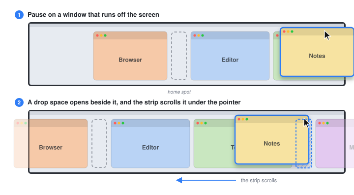

To reach windows further away, hold the pointer at the left or right edge of the screen. After a short moment the strip scrolls that way at a steady speed, and the drop space moves along beside each window that reaches the pointer. Move away from the edge to stop. If you let go while it's still scrolling, the window lands where the drop space shows.

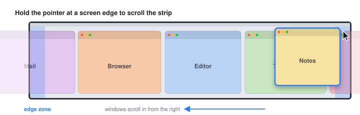

## Stacks and tabs

A **stack** is a column with several windows, one above another.

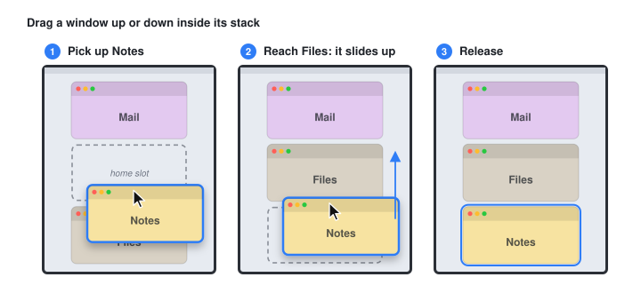

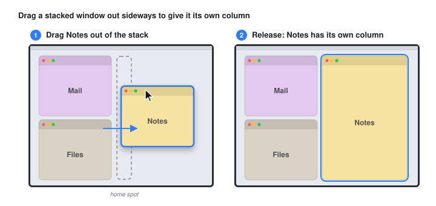

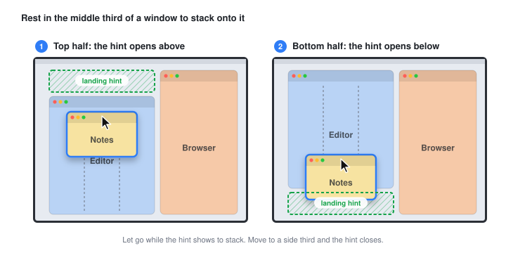

- **Reorder a stack:** drag a stacked window up or down. The other windows slide past it, and each keeps its own height.
- **Take a window out:** drag a stacked window sideways. Once a bit less than half of it is outside the column, it leaves the stack and a drop space opens beside the column on that side. From then on it's an ordinary drag.
- **Stack onto a window:** drag your window over the middle third of another window and rest there a moment. A thin **landing hint** opens above it (over the top half) or below it (over the bottom half); let go while it shows to join that stack. Move on to the left or right third and the hint closes. A window with less than 300 points on screen has no middle third; for a window partly off screen, the thirds are those of the visible part.
- **Width:** the new stack keeps the width of the column you stacked onto, and widens if your window can't be that narrow.
- **Not enough room:** if the windows can't all be as short as the stack needs, because an app won't let its window get that short, OmniWM takes the stacking back and shows a message over the window that went back. The same happens when a keyboard move or a resize leaves a stack without room. Taking windows out of a stack is never undone.
- **Moving a whole stack:** a stack can't be dragged as a whole. Move its windows one at a time, or make the column tabbed first and drag it by its title bar.

In a **tabbed column**, drag the title bar to move the column with all its tabs, drag an entry in the tab rail to pull that tab out, and rest a window over the column's middle third to add it as a tab: a blank entry appears right after the active tab, and letting go adds the window there.

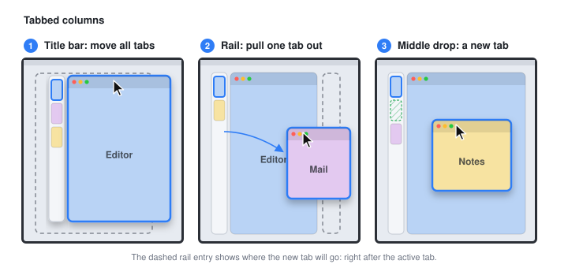

## Resizing

With macOS Fusion on, the usual macOS ways to resize a window work in the Niri layout, and the result stays.

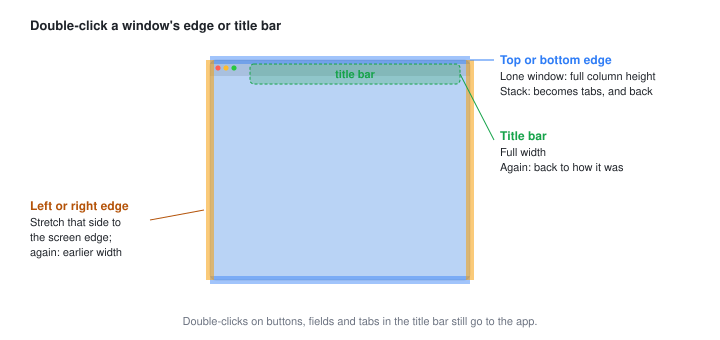

| Double-click | Window alone in its column | Window in a stack | Tabbed column |
| --- | --- | --- | --- |
| Top or bottom edge | Nothing: it always has the column's full height | The stack becomes tabbed | The tabs become a stack again |
| Left or right edge | That side stretches to the screen edge; again, the earlier width | Same, for the whole column | Same, for the whole column |
| Title bar | The column goes to full width; again, back to how it was | Same, for the whole column | Same, for the whole column |

- With **Center Focused Column** set to **Always**, a left or right edge double-click widens the column by the same amount and keeps it centred, so it doesn't reach the screen edge.
- A title-bar double-click puts the column back at its earlier width and place. If you resize it while it's at full width, the next double-click goes to full width again.
- Double-clicks on buttons, text fields and tabs in a title bar still go to the app.
- **Cycle Size Forward** (`Option + .`) and **Cycle Size Backward** (`Option + ,`) step through the preset widths. The cycle starts from the window's width: if that is visually a preset, the first step goes to the next one. A full cycle from a preset brings the window back to the width and place it started at.

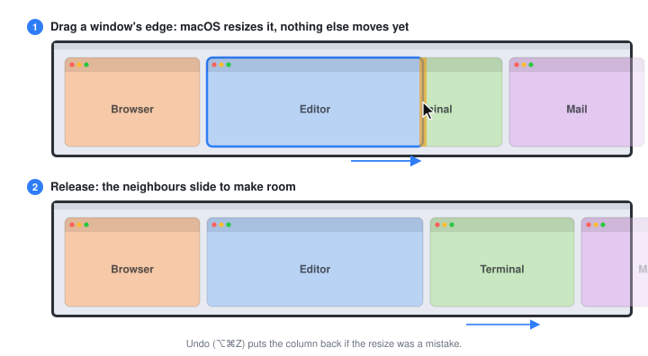

Drag a window's edge or corner to resize it as anywhere in macOS. When you let go, the windows around it slide to make room, and the side you didn't drag stays where it is. In a stack, dragging the edge between two windows changes their share of the column; the stack's outer top and bottom edges don't resize. A window alone in its column always fills the column's height.

## Peripheral Vision

**Peripheral Vision** keeps a strip of the next window in view at each screen edge that has more windows beyond it. Click a peek to bring that window into view. Columns and resizes leave room for the peeks, and when a scroll ends on a peek, the view slides a little so it stays clear.

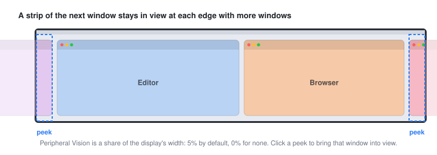

It is set as a share of the display's width, from 0% to 10% (5% by default; 0% turns it off). Each display can have its own value: pick the display at the top of the Niri settings and set **Peripheral Vision** in its **macOS Fusion** section. An edge shared with another display shows no peek.

## More than one display

Drag a window onto another display and it joins that display's strip: a drop space opens beside the window under the pointer, on the side of the half you're over, and everything works there as on the first display, including stacking. On a display with no windows, let go and the window lands there. It keeps the width it has on screen, up to what that display allows.

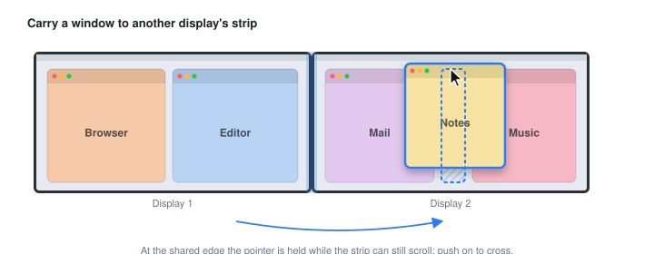

At the edge between two displays, the pointer holds for a moment while the strip can still scroll that way. Keep pushing to cross, or flick quickly to cross at once. A display that doesn't use a horizontal Niri strip (a Dwindle workspace, a portrait display or a fullscreen app) gets OmniWM's usual move instead.

## Undo and Redo

**Undo** (`Option + Command + Z`) takes back the last change to the windows in the workspace in front: a move, a stack, a resize or a column turned into tabs, from the mouse or the keyboard. Press it again to go further back, up to 20 changes. **Redo** (`Option + Shift + Command + Z`) puts back what Undo took back. Both keys can be changed in the **macOS Fusion** section of the Niri settings.

- Each workspace keeps its own history, so Undo never changes a workspace you can't see.
- A move to another workspace or display can be undone on either side. A swap between two displays is undone on both.
- Windows that closed since are left out, and windows that opened since stay where they are.
- The history lasts until OmniWM quits.

## Good to know

- **Niri on landscape displays only.** Dwindle, portrait displays and floating windows keep their usual behaviour.
- **Windows keep their width.** A window that moves into the strip keeps the width it has on screen. A new window takes the width from an app rule or a default column width other than Auto; otherwise the size its app opens it at.
- **Visible Containers doesn't apply.** With macOS Fusion on, each window keeps its own width, so **Visible Containers** is greyed out, and **Balance Sizes** shares the screen equally among the windows on screen.
- **A strip that fits is centred** as a whole when **Always Center Single Column** is on.
- **Drags cut short** put the layout back as it was before the drag.

## Settings

All in **Settings → Layouts → Niri**, in the **macOS Fusion** section. The config file keys are in the [settings reference](/config/settings-reference/).

| Setting | What it does | Default |
| --- | --- | --- |
| **macOS Fusion** (`macOSFusion`) | Move, stack and resize windows with the mouse as described here | Off |
| **Peripheral Vision** (`edgePeekPercent`) | How much of the next window stays in view at each screen edge with more windows, as a share of the display's width | 5% |
| **Undo** | Take back the last change to the windows in this workspace | `Option + Command + Z` |
| **Redo** | Put back what Undo took back | `Option + Shift + Command + Z` |
